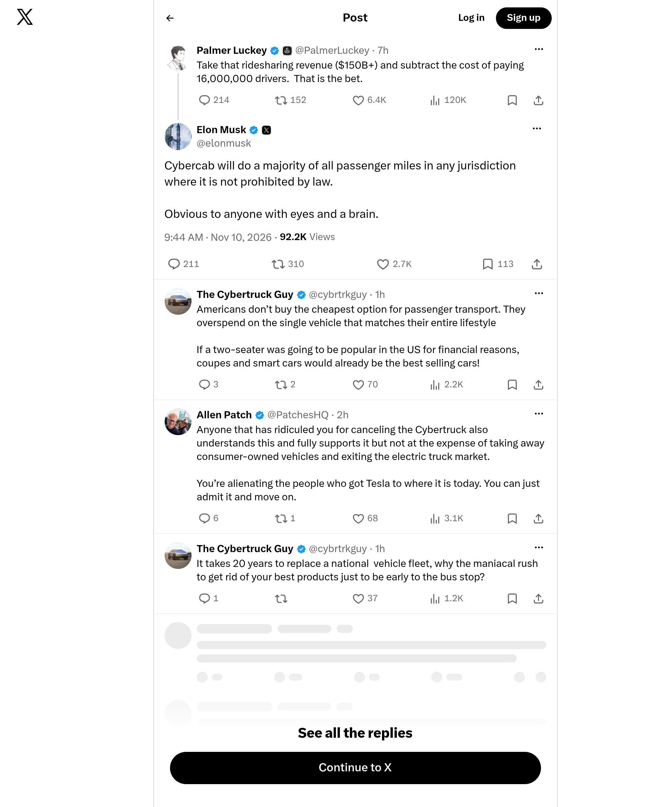

# Archived X screenshot — @elonmusk

[Full-size image](./screenshot.png) · [Full metadata](./metadata.json)

| Record | Value |
|---|---|
| Original post | https://x.com/elonmusk/status/2120090152429404655 |
| Author | @elonmusk |
| Post published (UTC) | 2026-11-10T09:44:16Z |
| Screenshot requested (UTC) | 2026-11-10T12:37:25Z |
| Image saved locally (UTC) | 2026-11-10T12:37:31Z |
| Record prepared (UTC) | 2026-11-10T12:37:32Z |
| File | `screenshot.png` |
| Dimensions | 2000 × 2400 px |

## Method

Automated screenshot of the original X page using the Microlink Screenshot API. The PNG was downloaded and preserved without further image editing or recompression. Full configuration is recorded in `metadata.json`.

The request used a 1000 × 1200 CSS-pixel viewport, JavaScript prerendering and a three-second wait. X popup/dialog layers were hidden to keep them from covering the post.

Surrounding posts and replies may be included. Content outside the viewport is excluded; videos appear as still images. Microlink may serve cached images: the provider's exact rendering time is unknown. The timestamps above describe the request and local archiving in our system.

Asset returned by Microlink: [PNG](https://iad.microlink.io/c6wP3OHzKKn1i8U7SmoEnlGIKA9K0T0Xje_5kFqkuO1T5BsoYrXbySUG4zp3QojDj3gQ9jaQ_dGby7bhwVH-mw.png)

## Integrity

SHA-256 (`screenshot.png`):

`efd93b983ce30ac3f75ee1959973bb375d1b43fec815ab87ecb223c2e9f49ac7`

This fingerprint verifies that a copy matches this image; it does not independently certify the capture time. Each new capture is stored in a separate folder. The first publication of this folder is recorded in GitHub's commit history.
