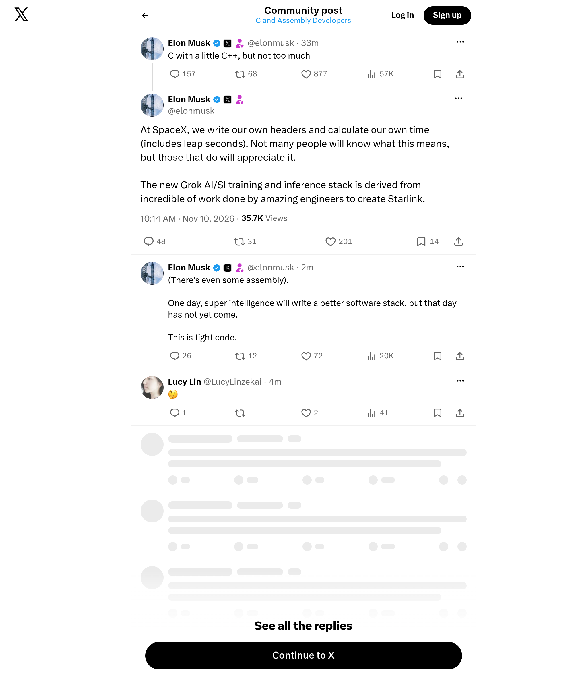

# Archived X screenshot — @elonmusk

[Full-size image](./screenshot.png) · [Full metadata](./metadata.json)

| Record | Value |
|---|---|
| Original post | https://x.com/elonmusk/status/2120097663794483601 |
| Author | @elonmusk |
| Post published (UTC) | 2026-11-10T10:14:07Z |
| Screenshot requested (UTC) | 2026-11-10T10:20:08Z |
| Image saved locally (UTC) | 2026-11-10T10:20:14Z |
| Record prepared (UTC) | 2026-11-10T11:43:14Z |
| File | `screenshot.png` |
| Dimensions | 2000 × 2400 px |

## Method

Automated screenshot of the original X page using the Microlink Screenshot API. The PNG was downloaded and preserved without further image editing or recompression. Full configuration is recorded in `metadata.json`.

The request used a 1000 × 1200 CSS-pixel viewport, JavaScript prerendering and a three-second wait. X popup/dialog layers were hidden to keep them from covering the post.

Surrounding posts and replies may be included. Content outside the viewport is excluded; videos appear as still images. Microlink may serve cached images: the provider's exact rendering time is unknown. The timestamps above describe the request and local archiving in our system.

For this capture predating the GitHub publisher, configuration was reconstructed from the collector version in use; no independent request manifest was preserved.

Asset returned by Microlink: [PNG](https://iad.microlink.io/afQLc-kbz8rhP5gbA8LqqrIgUyn2JYLCW14KWohWaBlKDAtjLJA3PFzndWbKvdt-pI3fmPXj6qhmxP2A16OAIA.png)

## Integrity

SHA-256 (`screenshot.png`):

`d5010b0b64693697a7305e75e254bcc5e62cdc024288f4a3df2958887ddb3f66`

This fingerprint verifies that a copy matches this image; it does not independently certify the capture time. Each new capture is stored in a separate folder. The first publication of this folder is recorded in GitHub's commit history.
