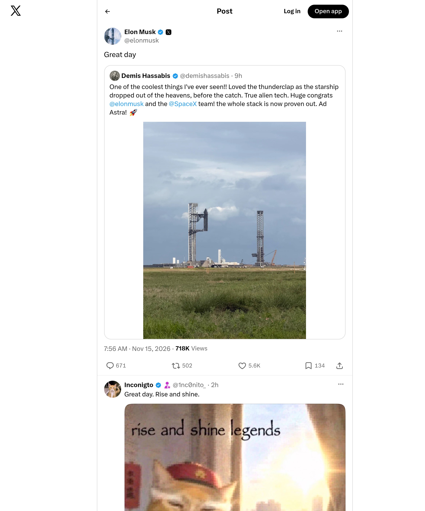

# Archived X screenshot — @elonmusk

[Full-size image](./screenshot.png) · [Full metadata](./metadata.json)

| Record | Value |
|---|---|
| Original post | https://x.com/elonmusk/status/2121875056817328621 |
| Author | @elonmusk |
| Post published (UTC) | 2026-11-15T07:56:50Z |
| Screenshot requested (UTC) | 2026-11-15T10:31:02Z |
| Image saved locally (UTC) | 2026-11-15T10:31:08Z |
| Record prepared (UTC) | 2026-11-15T10:32:02Z |
| File | `screenshot.png` |
| Dimensions | 2000 × 2400 px |

## Method

Automated screenshot of the original X page using the Microlink Screenshot API. The PNG was downloaded and preserved without further image editing or recompression. Full configuration is recorded in `metadata.json`.

The request used a 1000 × 1200 CSS-pixel viewport, JavaScript prerendering and a three-second wait. X popup/dialog layers were hidden to keep them from covering the post.

Surrounding posts and replies may be included. Content outside the viewport is excluded; videos appear as still images. Microlink may serve cached images: the provider's exact rendering time is unknown. The timestamps above describe the request and local archiving in our system.

Asset returned by Microlink: [PNG](https://iad.microlink.io/m4w5fJhbZStMtLOzfK27SbL49O_QWYjS-2OwgD7m0peOgDE7UTtY5x06LcdLkM_gWgVqUJPuITvnjHdxL3LW-A.png)

## Integrity

SHA-256 (`screenshot.png`):

`2996b61097bee9915de58e4c8b130f22d17e450d7a14008fd2039988ed8952ff`

This fingerprint verifies that a copy matches this image; it does not independently certify the capture time. Each new capture is stored in a separate folder. The first publication of this folder is recorded in GitHub's commit history.
