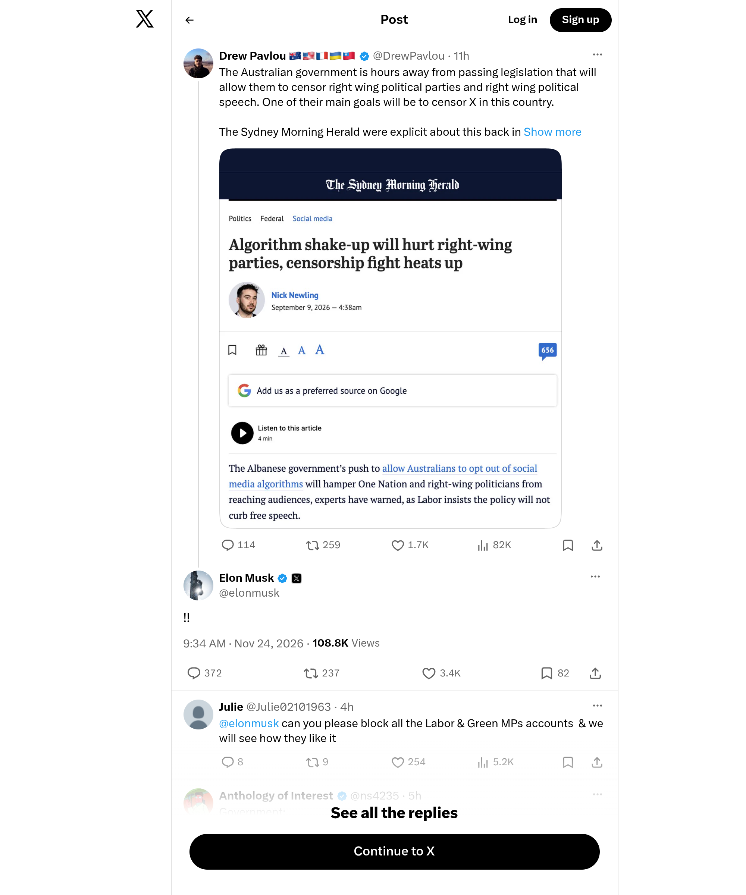

# Archived X screenshot — @elonmusk

[Full-size image](./screenshot.png) · [Full metadata](./metadata.json)

| Record | Value |
|---|---|
| Original post | https://x.com/elonmusk/status/2125161192293601624 |
| Author | @elonmusk |
| Post published (UTC) | 2026-11-24T09:34:46Z |
| Screenshot requested (UTC) | 2026-11-24T15:08:39Z |
| Image saved locally (UTC) | 2026-11-24T15:08:47Z |
| Record prepared (UTC) | 2026-11-24T15:09:15Z |
| File | `screenshot.png` |
| Dimensions | 2000 × 2400 px |

## Method

Automated screenshot of the original X page using the Microlink Screenshot API. The PNG was downloaded and preserved without further image editing or recompression. Full configuration is recorded in `metadata.json`.

The request used a 1000 × 1200 CSS-pixel viewport, JavaScript prerendering and a three-second wait. X popup/dialog layers were hidden to keep them from covering the post.

Surrounding posts and replies may be included. Content outside the viewport is excluded; videos appear as still images. Microlink may serve cached images: the provider's exact rendering time is unknown. The timestamps above describe the request and local archiving in our system.

Asset returned by Microlink: [PNG](https://iad.microlink.io/9gtN1nYsxMn99BwdaIjZTYK-twA6y7BSywTCvuvGF60YIOZu42jbgjfPhJ9Eaq3g_JEIsWK0LICxvZ_BistCbQ.png)

## Integrity

SHA-256 (`screenshot.png`):

`03f8c62db55e740073e88e2bc9f6fcb0842597bcf6730e9c66b9d219d2052465`

This fingerprint verifies that a copy matches this image; it does not independently certify the capture time. Each new capture is stored in a separate folder. The first publication of this folder is recorded in GitHub's commit history.
