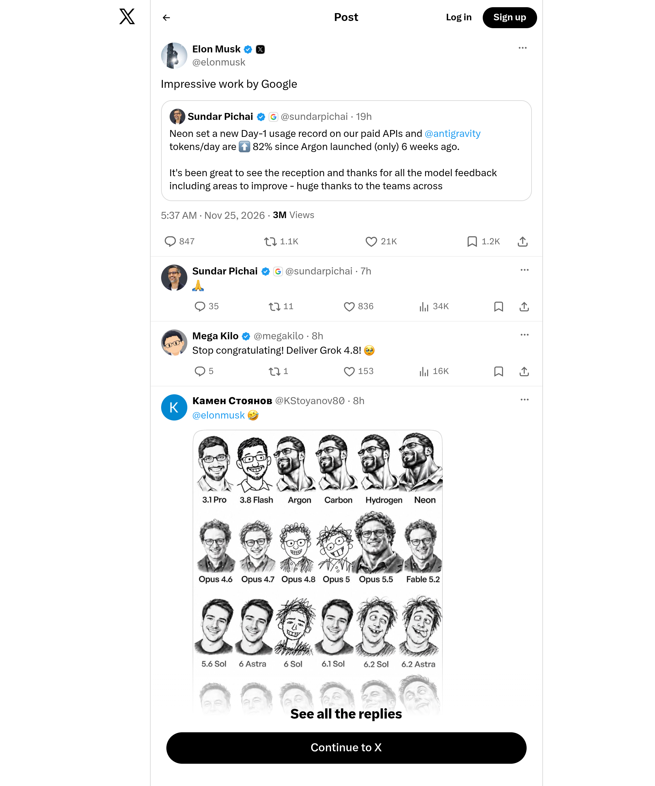

# Archived X screenshot — @elonmusk

[Full-size image](./screenshot.png) · [Full metadata](./metadata.json)

| Record | Value |
|---|---|
| Original post | https://x.com/elonmusk/status/2125463852146114994 |
| Author | @elonmusk |
| Post published (UTC) | 2026-11-25T05:37:26Z |
| Screenshot requested (UTC) | 2026-11-25T15:17:05Z |
| Image saved locally (UTC) | 2026-11-25T15:17:11Z |
| Record prepared (UTC) | 2026-11-25T15:18:22Z |
| File | `screenshot.png` |
| Dimensions | 2000 × 2400 px |

## Method

Automated screenshot of the original X page using the Microlink Screenshot API. The PNG was downloaded and preserved without further image editing or recompression. Full configuration is recorded in `metadata.json`.

The request used a 1000 × 1200 CSS-pixel viewport, JavaScript prerendering and a three-second wait. X popup/dialog layers were hidden to keep them from covering the post.

Surrounding posts and replies may be included. Content outside the viewport is excluded; videos appear as still images. Microlink may serve cached images: the provider's exact rendering time is unknown. The timestamps above describe the request and local archiving in our system.

Asset returned by Microlink: [PNG](https://iad.microlink.io/X-gicI3rklcL5Ypd2uTQCPgw2KN3z3hPR9_wZgOxFi93dfNSbwfXVz7kh-XZNFGxeOgCp6FYf3vveQ3PE7MldA.png)

## Integrity

SHA-256 (`screenshot.png`):

`d843fe303f83d51d3970d0938410025a8da7ad7e05e65c63b820d40f9a4f9a21`

This fingerprint verifies that a copy matches this image; it does not independently certify the capture time. Each new capture is stored in a separate folder. The first publication of this folder is recorded in GitHub's commit history.
